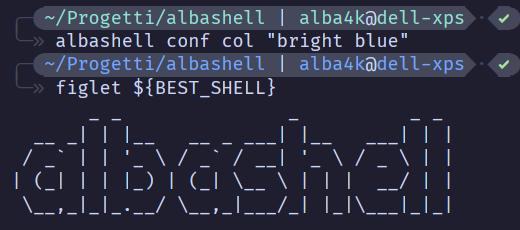

# albashell
Yet another UNIX shell, built in Rust

It ain't much but it's honest work

---

Roadmap (stuff I'd like to add in the near future):
- [x] cd
- [x] echo
- [x] type
- [x] exit
- [x] color config
- [x] history
- [x] parse quotes
- [x] escape sequences
- [x] chaining with `&&`, `||`, `;`
- [x] export
- [x] parse env with `${VAR}`
- [x] expand `~`
- [ ] functions
- [ ] alias
- [ ] better type (binary path / not found)
- [ ] `which`
- [ ] async exec with `&`, `disown`
- [ ] stream redirect
- [ ] pipes
- [ ] `... $(...)`
- [ ] `cd -`
- [ ] if/else/while/for?
- [ ] scripting
- [ ] cmdline arguments `--help`, `-c`, `-v`
- [ ] set `ALBASHELL_*` variables for info (?)
- [ ] runtime, git, etc in prompt

---

Prompt inspired by [IlanCosman/tide](https://github.com/IlanCosman/tide)
